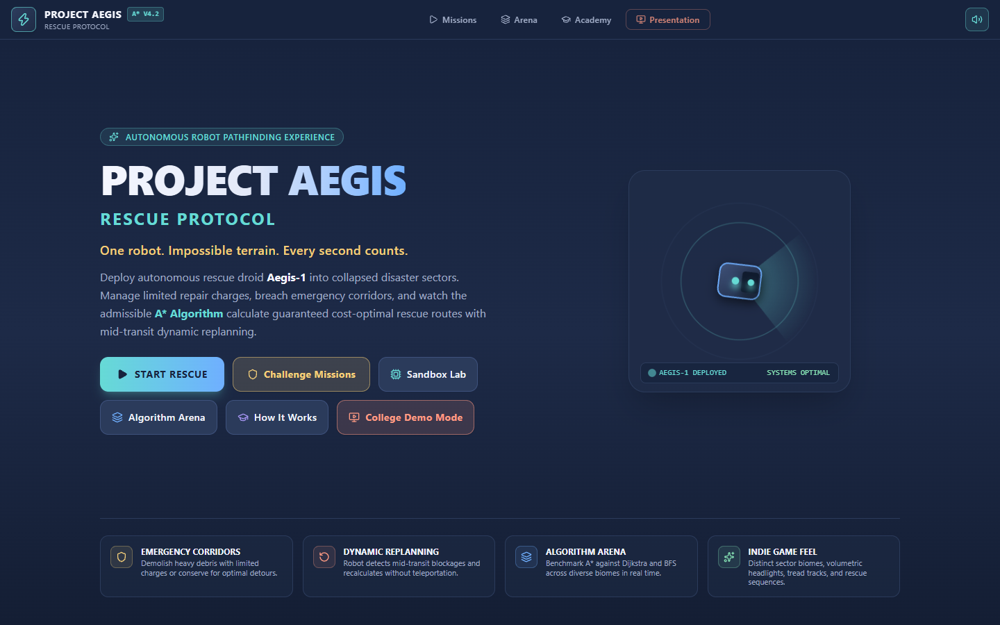
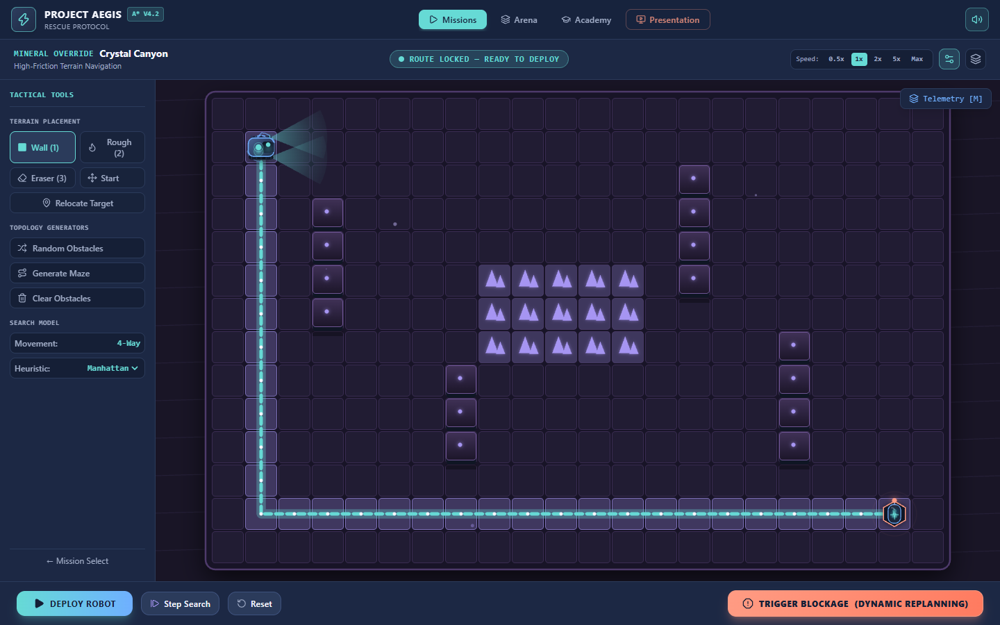
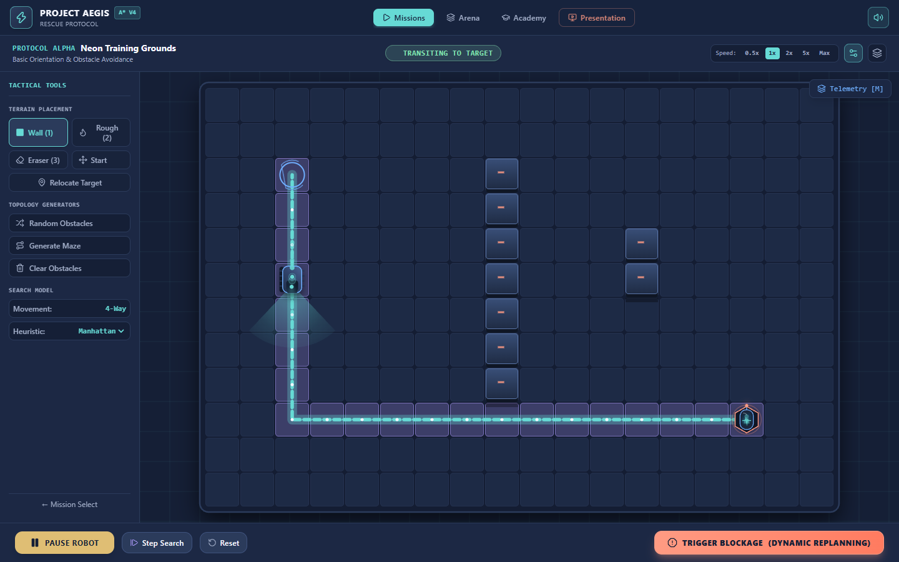
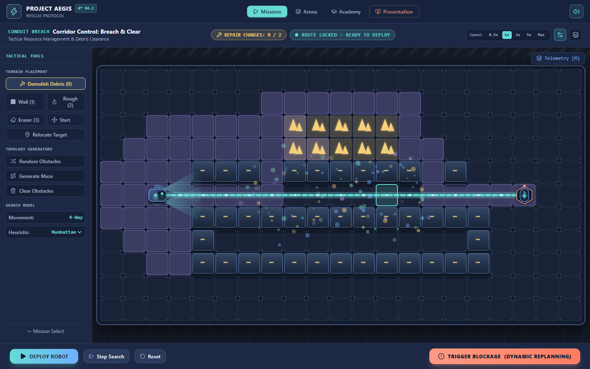
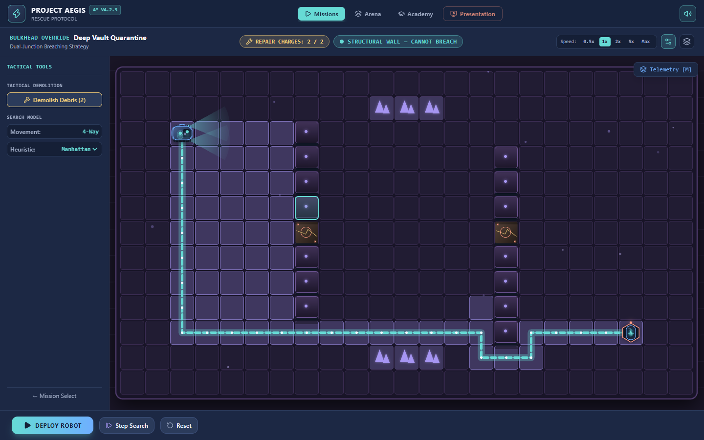
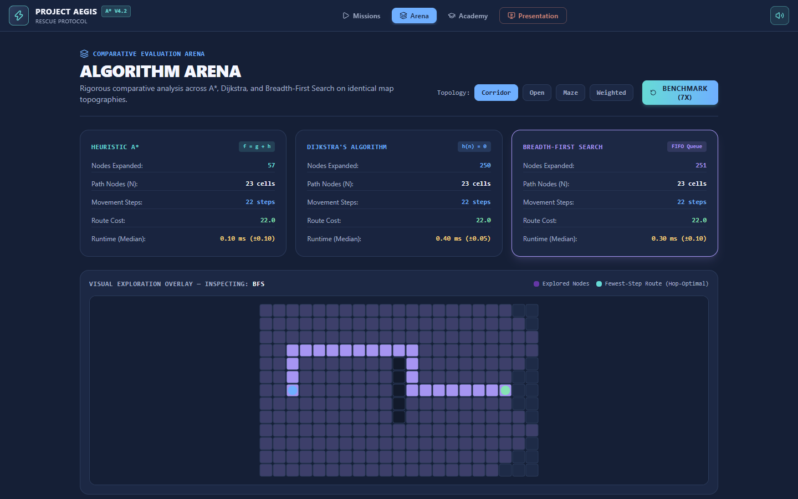
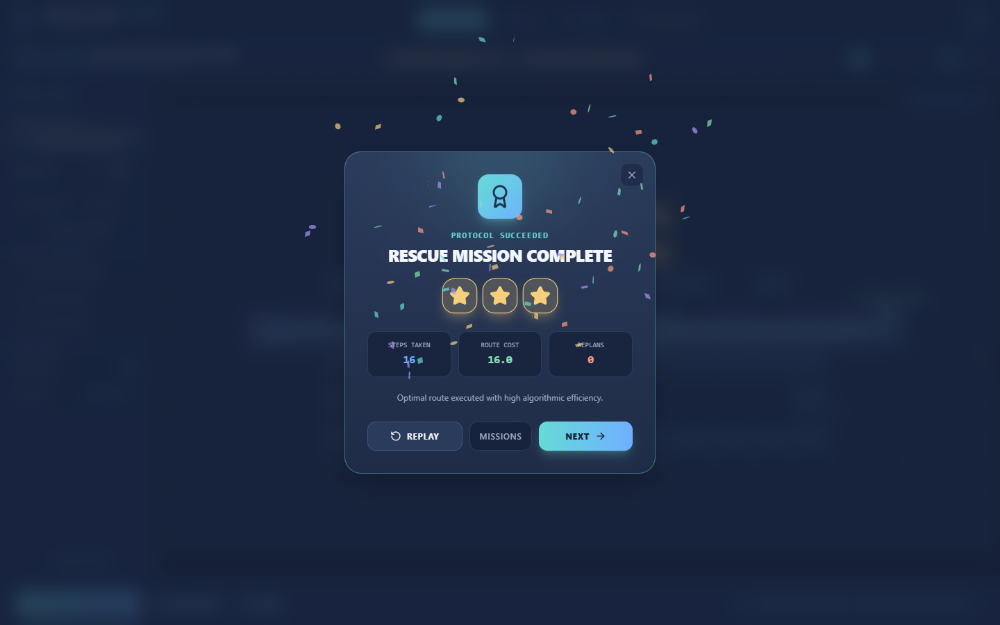

# PROJECT AEGIS: RESCUE PROTOCOL

> *"One robot. Impossible terrain. Every second counts."*

[](https://project-aegis-theta.vercel.app/)
[](https://github.com/ahamedbafan786-png/project-aegis-rescue-protocol/actions/workflows/ci.yml)
[](LICENSE)
[](tests)
[](tsconfig.json)
[](package.json)
[](src/index.css)

**Project Aegis: Rescue Protocol** is an interactive, game-like autonomous robot pathfinding demonstration developed in pure TypeScript, React 19, and HTML5 Canvas. Built for students, software engineers, roboticists, and algorithm enthusiasts, it brings formal graph traversal algorithms to life inside a responsive, sci-fi tactical simulation.

The player acts as Tactical Mission Commander deploying an autonomous rescue droid (**Aegis-1**) across hazardous disaster zones. The simulation showcases a mathematically rigorous, strictly admissible A* pathfinding engine featuring **real-time mid-transit dynamic replanning**: when dynamic obstructions collapse onto the active path, Aegis-1 detects the blockage, halts safely without clipping or teleportation, executes an instant A* recalculation from its current cell, and maneuvers through an alternate optimal route.

---

## Play the Game

Experience the live, interactive deployment directly in your browser:

### 🎮 **[https://project-aegis-theta.vercel.app/](https://project-aegis-theta.vercel.app/)**

*Zero installation required. Works on all modern desktop, tablet, and mobile browsers.*

---

## Gameplay Showcase

All screenshots below are captured from live production runs of the application.

### 1. Main Menu & Command Deck
*Interactive radar canvas with tactical deployment options, sound synthesis toggle, and mission selector.*


### 2. Actual Gameplay & Disaster Environments
*Tactical grid view featuring high-contrast terrain rendering, rough crystalline fields (3× movement cost), and ambient occlusion.*


### 3. Rescue Robot Navigation
*Aegis-1 moving along the calculated optimal path with glowing thruster particles, directional visor orientation, and continuous sub-pixel interpolation.*


### 4. Dynamic A* Replanning
*When structural collapse blocks the transit corridor, Aegis-1 halts immediately, updates its state, and recalculates an alternate optimal route through the upper bypass.*


### 5. Challenge Missions & Repair Mechanics
*Strategic challenge mode requiring players to manage limited repair charges, breach designated debris, and respect structural wall immunity.*


### 6. Algorithm Arena (Comparative Benchmark)
*Side-by-side performance analysis comparing `A*`, `Dijkstra`, and `BFS` on identical topologies with live node expansion telemetry.*


### 7. Rescue Completion & Debriefing
*Docking sequence with survivor cryo-pod, confetti celebration, procedural fanfare, and 3-star performance debrief.*


---

## Features

- **Interactive Autonomous Rescue Robot**: Custom Aegis-1 droid model with continuous sub-pixel positional interpolation, directional orientation, sensor light cone, glowing central power core, and delta-time thruster particles.
- **Pure TypeScript A\* Pathfinding**: Zero external pathfinding libraries. Implemented from first principles using strictly admissible heuristics and custom binary min-heaps.
- **Real-Time Dynamic Replanning**: Instant path invalidation observer detects runtime obstructions, halts the droid at its nearest valid coordinate without teleportation, and recomputes the optimal detour on the fly.
- **Interactive Challenge Missions**: Scenarios requiring resource management, such as *Corridor Control*, where commanders choose between spending repair charges to blast through designated debris or taking longer alternate routes.
- **Debris Clearance & Wall Immunity**: Dedicated repair energy charges can breach designated emergency debris while preserving permanent structural perimeter walls.
- **Distinct Rescue Environments**: Handcrafted scenarios with unique topologies:
  - *Urban Ruins*: Open rubble field with multiple viable routes.
  - *Seismic Canyon*: Chokepoint navigation with high-friction crystalline fields.
  - *Subterranean Maze*: Dense corridors demanding deep heuristic guidance.
  - *Corridor Control*: Strategic challenge mode balancing repair charges against detour length.
  - *Sandbox Lab*: Full creative canvas with custom wall, rough terrain, and eraser tools.
- **Algorithm Arena (3-Way Benchmark)**: Direct side-by-side comparison of **A\***, **Dijkstra**, and **BFS** measuring explored nodes, path length, step cost, and microsecond execution time.
- **Presentation Mode**: 60-second high-contrast exhibition mode tailored for auditorium projectors, complete with an **Auto-Hold** toggle for live classroom demonstrations.
- **Procedural Audio Synthesizer**: Native browser Web Audio API sound engine generating sci-fi UI clicks, servo motors, warning alarms, sonar pings, and victory fanfare without external audio files.
- **Fully Responsive Architecture**: Dedicated desktop layout, tablet drawer navigation, and mobile viewports (390×844 and 543×589) with persistent telemetry overlays.

---

## Technology Stack

| Layer | Technology | Details |
| :--- | :--- | :--- |
| **Framework** | [React 19.3](https://react.dev/) | Modern functional components, strict hooks, zero legacy patterns |
| **Language** | [TypeScript 6.0](https://www.typescriptlang.org/) | Strict mode enabled, comprehensive interfaces for grid models and telemetry |
| **Bundler & Tooling** | [Vite 8.3](https://vitejs.dev/) | Lightning-fast HMR and optimized production bundling |
| **Styling** | [Tailwind CSS v4](https://tailwindcss.com/) | Modern utility-first CSS engine with custom color palettes |
| **Graphics Engine** | HTML5 Canvas 2D | Custom render pipeline with delta-time animation loop and particle physics |
| **Audio** | Web Audio API | Procedural waveform synthesis (sine, square, sawtooth) with gain nodes |
| **Unit Testing** | [Vitest 5.0](https://vitest.dev/) | 63 automated tests verifying admissibility, min-heap properties, and replanning |
| **Browser QA** | [Puppeteer](https://pptr.dev/) | End-to-end automated screenshot verification across viewport sizes |
| **Hosting** | [Vercel](https://vercel.com/) | Continuous deployment with global edge CDN delivery |

---

## Algorithms & Mathematical Foundation

### 1. The A* Search Algorithm
A* evaluates candidate nodes using the evaluation function:

$$f(n) = g(n) + h(n)$$

Where:
- **$g(n)$**: The exact, known path cost from the start node to node $n$.
- **$h(n)$**: The estimated heuristic cost from node $n$ to the goal.
- **$f(n)$**: The estimated total cost of the cheapest solution passing through node $n$.

### 2. Heuristic Admissibility and Consistency
A heuristic is **admissible** if it never overestimates the true cost to reach the goal:

$$h(n) \le h^*(n), \quad \forall n$$

Project Aegis strictly adheres to admissibility with zero artificial inflation:
- **Manhattan Distance** ($L_1$ norm): Used for 4-directional orthogonal grid traversal:
  $$h(n) = |r_n - r_{goal}| + |c_n - c_{goal}|$$
- **Octile Distance**: Used when 8-directional traversal is configured, accounting for diagonal cost ($\sqrt{2} \approx 1.414$):
  $$h(n) = \min(\Delta r, \Delta c) \cdot \sqrt{2} + |\Delta r - \Delta c|$$

### 3. Binary Min-Heap Priority Queue
To guarantee $O((V + E) \log V)$ time complexity, open set nodes are managed by a custom generic binary heap (`src/algorithms/minHeap.ts`):
- Node insertion: $O(\log N)$
- Minimum element extraction: $O(\log N)$
- Multi-tier tie-breaking:
  1. Lowest $f(n)$
  2. Highest $g(n)$ (prioritizes nodes closer to the goal along promising paths)
  3. Lowest $h(n)$

### 4. Dynamic Path Recalculation
Unlike static solvers, Project Aegis decouples discrete logical grid cells $(r, c)$ from continuous sub-pixel visual coordinates $(x, y, \theta)$. On every simulation tick:
1. The robot checks if any cell along its planned path has been mutated into an obstacle (`WALL`).
2. If blocked, transit halts immediately and integer coordinates are snapped to prevent spatial drift.
3. A localized A* recalculation is executed from the current safe coordinate to the target.
4. The new path is attached seamlessly with a sub-millisecond transition.

### 5. Weighted Terrain Mechanics
The environment supports heterogeneous edge costs:
- **Normal Floor**: Cost = $1.0$
- **Rough Crystalline Terrain**: Cost = $3.0$
- **Walls**: Impassable ($\infty$)

Both A* and Dijkstra naturally discover that routing through up to 2 empty floor tiles to bypass a single rough tile produces a lower total path cost ($2.0 < 3.0$), illustrating cost-optimal behavior over shortest-step heuristics.

---

## Installation and Running Locally

### Prerequisites
- [Node.js](https://nodejs.org/) `^22.12.0 || ^24.0.0 || >=26.0.0` (Recommended: Node.js 22 LTS; tested on v22.12+)
- `npm` v10.0.0 or higher

### 1. Clone the Repository
```bash
git clone https://github.com/ahamedbafan786-png/project-aegis-rescue-protocol.git
cd project-aegis-rescue-protocol
```

### 2. Install Dependencies
```bash
npm install
```

### 3. Start Development Server
```bash
npm run dev
```
Navigate to `http://localhost:5173/` in your browser.

### 4. Build for Production
```bash
npm run build
```
The optimized production bundle will be output to the `dist/` directory.

---

## Testing & Verification

Project Aegis includes comprehensive unit and integration tests covering the algorithmic core and gameplay state machine.

### Run Automated Unit Tests
```bash
npm test
```

#### Test Suite Summary
```text
 ✓ tests/minHeap.test.ts (3 tests)
 ✓ tests/heuristics.test.ts (4 tests)
 ✓ tests/robotCostAccounting.test.ts (5 tests)
 ✓ tests/challengeMechanic.test.ts (4 tests)
 ✓ tests/astar.test.ts (12 tests)
 ✓ tests/v4_2_1_gameplay_integrity.test.ts (26 tests)

 Test Files  6 passed (6)
      Tests  54 passed (54)
```

Key verified behaviors:
- Binary heap priority ordering, bubbling, and duplicate handling.
- Admissibility bounds ($h \le h^*$) across uniform and obstacle grids.
- Corner-cutting prevention across diagonal walls.
- Mid-transit dynamic replanning and detour selection.
- Ordinary structural wall demolition immunity.
- Mobile repair counter synchronization and drawer exclusivity.

### Run Code Linter
```bash
npm run lint
```

---

## Project Structure

```
project-aegis-rescue-protocol/
├── public/                  # Static assets and icons
├── src/
│   ├── algorithms/          # Pure TypeScript algorithmic core
│   │   ├── astar.ts         # A* pathfinding implementation
│   │   ├── bfs.ts           # Breadth-First Search implementation
│   │   ├── dijkstra.ts      # Dijkstra's shortest path implementation
│   │   ├── heuristics.ts    # Admissible distance functions (Manhattan, Octile)
│   │   ├── minHeap.ts       # Custom binary MinHeap priority queue
│   │   └── types.ts         # Type definitions (GridCoord, PathResult, Telemetry)
│   ├── components/          # React tactical user interface
│   │   ├── AlgorithmAcademy.tsx  # Interactive Viva and DSA study guide
│   │   ├── AlgorithmArena.tsx    # 3-way live benchmark comparison
│   │   ├── GameHUD.tsx           # Primary commander HUD & simulation canvas
│   │   ├── MainMenu.tsx          # Title screen with interactive radar
│   │   ├── MissionResultsModal.tsx # Debrief and star rating dialog
│   │   ├── MissionSelect.tsx     # Scenario selection deck
│   │   ├── Navbar.tsx            # Header navigation & audio controls
│   │   └── PresentationMode.tsx  # High-contrast auditorium presentation screen
│   ├── game/                # Simulation engine & game logic
│   │   ├── aegisRenderer.ts      # Canvas 2D rendering pipeline & particle emitter
│   │   ├── editPermissions.ts    # Centralized mission edit permissions
│   │   ├── gridModel.ts          # Matrix representation & topology generator
│   │   ├── robotController.ts    # State machine & dynamic replanning observer
│   │   └── soundEngine.ts        # Synthesized Web Audio API sound generator
│   ├── missions/            # Mission definitions & disaster topographies
│   │   └── missionData.ts
│   ├── App.tsx              # Application root state & screen routing
│   ├── index.css            # Tailwind CSS styling & custom effects
│   └── main.tsx             # Application DOM mounting point
├── tests/                   # Automated Vitest test suites (63 unit tests across 7 suites)
│   ├── astar.test.ts
│   ├── challengeMechanic.test.ts
│   ├── heuristics.test.ts
│   ├── minHeap.test.ts
│   ├── robotCostAccounting.test.ts
│   ├── v4_2_1_gameplay_integrity.test.ts
│   └── v4_2_2_stability_mobile.test.ts
├── screenshots/             # High-resolution gameplay captures
├── scripts/                 # Puppeteer automated browser QA suites
├── DEMO_GUIDE.md            # Live viva presentation script & defense cheat sheet
├── FINAL_QA_REPORT.md       # Comprehensive browser QA audit report
├── V4_2_1_GAMEPLAY_INTEGRITY_REPORT.md # Hotfix verification documentation
├── LICENSE                  # MIT License
├── package.json             # Project dependencies and npm scripts
├── tsconfig.json            # TypeScript configuration
└── vite.config.ts           # Vite build pipeline configuration
```

---

## Educational Purpose & DAA Applications

Project Aegis was designed as an interactive academic demonstration for courses in **Design & Analysis of Algorithms (DAA)**, **Artificial Intelligence**, and **Robotics**:

1. **Concrete Visualization of Abstract Data Structures**: Instead of visualizing nodes on a chalkboard, students see priority queues, open sets, and closed sets active in real time.
2. **Admissibility & Optimality in Action**: Formally illustrates why an admissible heuristic guarantees optimal path length without needing to explore every node like Dijkstra.
3. **Exploration Efficiency**: Direct side-by-side telemetry in the Algorithm Arena demonstrates that A* explores a fraction of the nodes visited by Dijkstra on identical maps.
4. **Dynamic Environmental Invalidation**: Bridges the gap between static graph algorithms and real-world robotics, where obstacles are dynamic and real-time replanning is critical.

---

## Future Improvements

The following features are planned for future releases:

- [ ] **Jump Point Search (JPS)**: Path acceleration algorithm for uniform grid maps to bypass symmetric paths.
- [ ] **Hierarchical Pathfinding (HPA\*)**: Multi-level sector abstraction for massive disaster maps (100×100+).
- [ ] **Multi-Agent Coordination**: Simultaneous deployment of Aegis-1, Aegis-2, and Aegis-3 with conflict-based collision avoidance (CBS).
- [ ] **Dynamic Environmental Hazards**: Expanding toxic gas plumes and spreading fires with time-decaying traversal costs.
- [ ] **Custom Level Export & Import**: Save and share custom disaster topographies in JSON format.

---

## Credits and License

- **Developer & Maintainer**: [ahamedbafan786-png](https://github.com/ahamedbafan786-png)
- **Domain**: Design & Analysis of Algorithms / Autonomous Robotics Simulation
- **License**: Released under the [MIT License](LICENSE).
